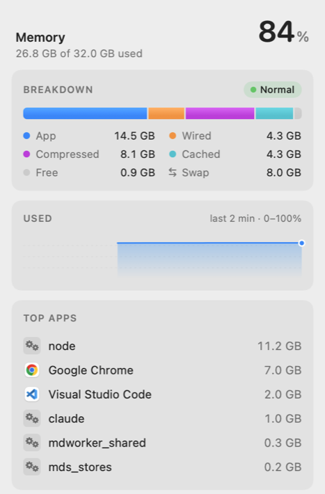
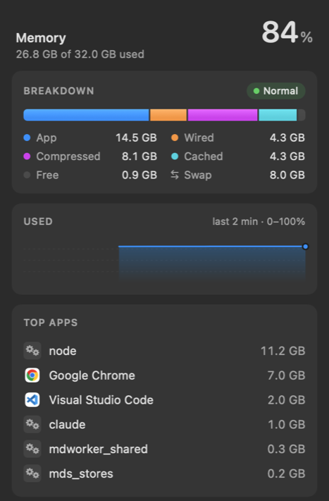

# MemoryBar

A tiny, native macOS menu bar app that shows how much RAM you're using, and what's using it.

<p align="center">
  
</p>

<p align="center">
  
  &nbsp;
  
</p>

## Features

- **Memory at a glance.** A memory chip icon in the menu bar with your current usage. Show it as a percentage, GB used, GB available, or the icon alone.
- **Pressure warnings.** The icon and number turn orange or red when macOS reports memory pressure, the same signal Activity Monitor uses.
- **Breakdown.** App memory, wired, compressed, cached, free and swap, using the same definitions as Activity Monitor.
- **History.** A graph of the last 2 minutes of usage.
- **Top apps.** The 6 apps using the most memory, with their icons. Helper processes are added to their app, so Chrome shows as one entry, not 30.
- **Native and light.** One Swift file using AppKit and SwiftUI. It follows light and dark mode and has no Dock icon. At idle it uses about 0.1% CPU and about 30 MB of RAM.
- **Private.** No network access, no analytics, no accounts.
- **Open at login**, if you turn it on in its settings menu.

Requires **macOS 13 Ventura or later**, on Apple Silicon or Intel.

## Install

### Option 1: Download the app

1. Download **[MemoryBar.zip](https://github.com/mukonoeddington/MemoryBar/releases/latest/download/MemoryBar.zip)** from the [latest release](https://github.com/mukonoeddington/MemoryBar/releases/latest).
2. Unzip it and drag **MemoryBar.app** into your **Applications** folder.
3. Open it. The first time, macOS will block it. MemoryBar isn't notarized by Apple because that requires a paid developer account. To allow it, do one of these:
   - Open **System Settings → Privacy & Security**, scroll down, and click **Open Anyway** next to the MemoryBar message. Then open the app again.
   - Or run this once in Terminal:
     ```bash
     xattr -dr com.apple.quarantine /Applications/MemoryBar.app
     ```

The memory chip icon then appears in your menu bar.

### Option 2: Build it yourself

If you'd rather not run a downloaded binary, build it from source. It takes about a minute. You need Apple's command line tools:

```bash
xcode-select --install          # skip if already installed
git clone https://github.com/mukonoeddington/MemoryBar.git
cd MemoryBar
./build.sh
mv MemoryBar.app /Applications/
open /Applications/MemoryBar.app
```

macOS doesn't block apps you build yourself.

## Use

- **Click** the icon to open the popover.
- **The gear** at the bottom of the popover lets you:
  - choose what the menu bar shows (percent, GB used, GB available, or icon only)
  - turn **Open at login** on or off (the app must be in `/Applications`)
  - quit
- **Activity Monitor** opens Apple's Activity Monitor for more detail.

## What the numbers mean

| Label | Meaning |
| --- | --- |
| **Used** | App memory + wired + compressed. This matches "Memory Used" in Activity Monitor. |
| **App** | Memory that apps are actively using. |
| **Wired** | Memory the system has locked in place. It can't be compressed or swapped out. |
| **Compressed** | Memory macOS has compressed to make room. |
| **Cached** | File cache and purgeable memory. macOS frees it immediately when apps need it. |
| **Free** | Everything else. |
| **Swap** | Memory written to disk because RAM was full. |
| **Pressure** | macOS's own judgement of whether memory is running low: **Normal**, **Warning** or **Critical**. This is a better health signal than the percentage. High usage with Normal pressure is fine, because macOS keeps RAM full on purpose. |

## Uninstall

Quit MemoryBar from its gear menu. Then delete `/Applications/MemoryBar.app`. If you turned on Open at login, turn it off first, or remove MemoryBar under **System Settings → General → Login Items**.

## Build details

`build.sh` compiles `main.swift` with `swiftc` for both `arm64` and `x86_64`, combines them into a universal binary, and writes a minimal `Info.plist`. The app gets an ad-hoc signature. `./build.sh --zip` also creates `MemoryBar.zip` for a release. No Xcode project is needed.

## Contributing

Issues and pull requests are welcome. All the code is in [`main.swift`](main.swift).

## License

[MIT](LICENSE)
